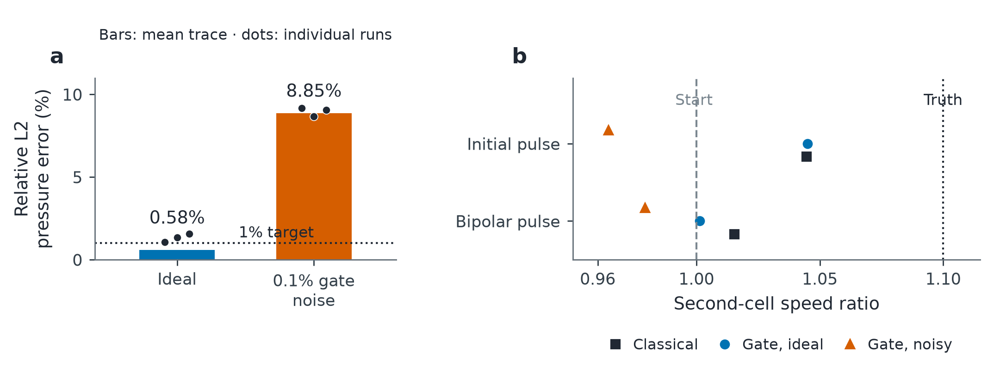
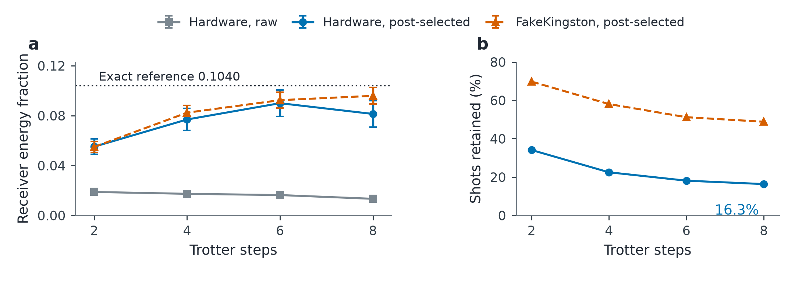
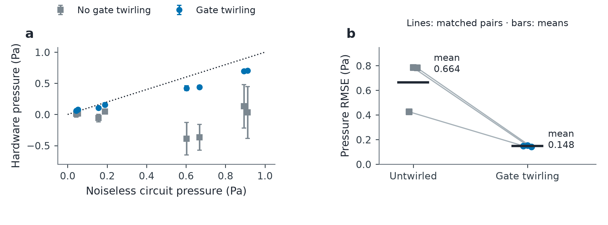
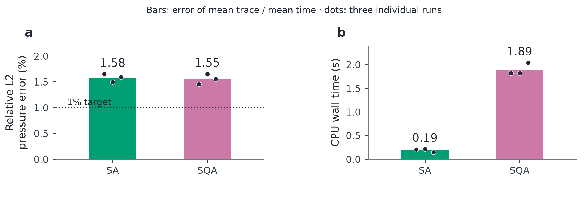
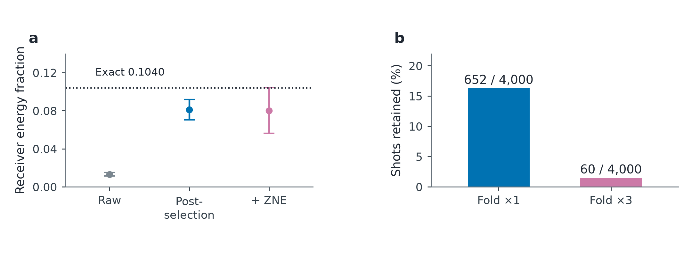
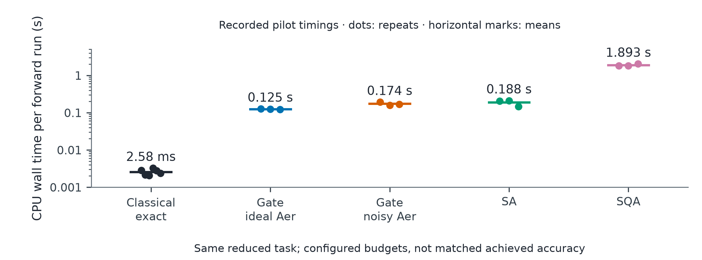
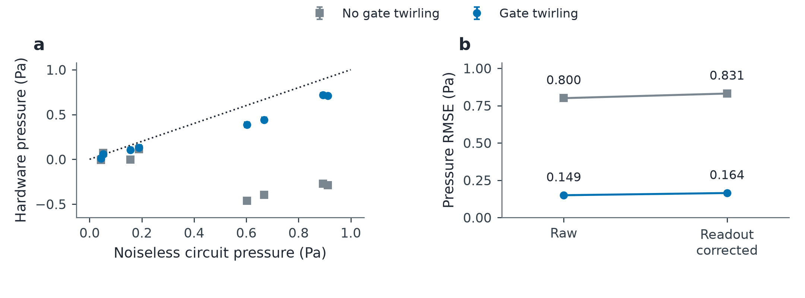

# Results and evidence

All figures below are derived from saved experiment files. [`reproduce.py`](reproduce.py) verifies those files and redraws the figures without running a wave solver or contacting IBM. Each figure is available as PNG, vector PDF and editable SVG in [`figures/`](figures). Full scientific captions are in [`captions.json`](captions.json).

## 1. Simulator validation

Bars show the relative L2 error of the **mean trace** over three forward repeats; dots show individual-repeat errors. Ideal: 0.583% for the mean trace, but 1.076%, 1.333% and 1.565% individually. Noisy: 8.854% for the mean trace. The target required **every** repeat to be within 1%, and was missed. Noise is generic 0.1% gate depolarization, not an IBM calibration model.

The pilot has two cells, two transmitters, two receivers, two observation times and 8,192 shots/circuit. Reconstruction points show the final second-cell speed ratio after two updates, one run per condition. Synthetic observations come from the same exact discrete model. Matched observations and acquisition/inversion signatures were verified; these tests do not establish convergence or clinical accuracy.

**Evidence:** [`pilot_results.tar.gz`](sources/handoff/pilot_results.tar.gz), [`reconstruction_runs.tar.gz`](sources/handoff/reconstruction_runs.tar.gz), [`audited_simulations.json`](sources/audited_simulations.json). Archives include source snapshots, package versions, configurations, count files, optimizer histories and completion/failure records. The reconstruction [execution patch](sources/handoff/simulator_forward.diff) is preserved.

## 2. IBM wave-energy demonstration

One 15-qubit unary job on `ibm_marrakesh`, six circuit conditions with 4,000 shots each; **9 charged QPU seconds**. The figure shows healthy, unfolded conditions across Trotter depths. Raw means the probability of the **receiver-only bitstring**, not the receiver-qubit marginal. Post-selection retains single-excitation bitstrings. Error bars are estimated sampling standard errors, not variation across independent jobs.

FakeKingston is a different-device noise-model comparison. Wave energy is a different observable from the signed pressure in the next experiment.

**Evidence:** job `db9smd9gv2cc73e60pm0`; [raw counts](sources/handoff/3_ibm_job/raw_counts.json), [IBM metadata](sources/handoff/3_ibm_job/job_metadata.json), [submission source](sources/handoff/3_ibm_job/submit_script.py), [aggregates](sources/hardware_ibm_marrakesh.json). The submission source imports the original `qwave` implementation from the [pinned partner repository](https://github.com/AnikS22/IBM_Qiskit_Fallfest/tree/a42140befaddeb18fd6296c829a39e045e6fd573).

## 3. IBM signed pressure: repeated gate-twirling comparison

Three pairs on `ibm_kingston`, using identical saved ISA circuits on physical qubits 81, 82, 83 and 96. Each job contains eight wave circuits and four readout calibrations at 4,096 shots/circuit. Twirled jobs use 32 randomizations × 128 shots. Pair order was U/T, T/U, U/T; the design was saved before submission. No dynamical decoupling, measurement twirling or quantum error correction was used in this campaign.

| Pair | Untwirled RMSE (Pa) | Twirled RMSE (Pa) | Reduction |
| --- | ---: | ---: | ---: |
| 1 | 0.42544 | 0.14891 | 65.00% |
| 2 | 0.78434 | 0.15278 | 80.52% |
| 3 | 0.78189 | 0.14125 | 81.93% |
| Mean | **0.66389** | **0.14765** | **77.76% reduction in mean RMSE** |

RMSE is measured against the saved noiseless **circuit** reference, across the eight pressure observations. The headline is `1 − mean(twirled RMSE) / mean(untwirled RMSE)`, not an average of pairwise percentages. The mean paired absolute reduction is 0.51624 Pa. Error bars in panel a are sample standard deviations over three jobs; they are not confidence intervals. Controls visibly drifted, and only one backend/calibration period was tested.

Readout calibration passed in every job, but assignment correction **worsened all six RMSEs**; corrected means were 0.68385 and 0.16232 Pa. All conditions, including this negative result, are retained. Six repeat jobs used **99 charged QPU seconds**; two earlier exploratory pilots used 12 more and are excluded from these summaries.

**Evidence:** [`design.json`](sources/pressure_paired_hardware/design.json), [`collected.json`](sources/pressure_paired_hardware/collected.json), [compiled circuit records](sources/pressure_paired_hardware/pilot_circuits.json), [saved ISA circuits](sources/pressure_paired_hardware/pilot_isa.qpy), [reference](sources/pressure_paired_hardware/reference.json), [raw counts, Runtime results and metrics](sources/pressure_paired_hardware), [derived metrics](figures/pressure_paired_metrics.json). Each run also contains its source snapshot and the original submission script. Those archived submission scripts record the original local paths/account selector; they are evidence, not portable one-command rerun instructions.

## 4. Simulated annealing comparison

SA is the classical annealing control; SQA is a **classical CPU path-integral simulation** using D-Wave samplers. No IBM annealer or annealing hardware was used. Both optimize the same fixed-point Crank–Nicolson QUBOs with 6-bit encoding, three refinements, 16 reads and 200 sweeps; three repeats per method, two workers.

Mean-trace relative L2 errors were 1.576% (SA) and 1.549% (SQA). Mean recorded CPU wall times were 0.1878 and 1.8927 seconds. SQA took 10.08× longer in this test; neither method met the every-repeat 1% target. Dots show individual repeats. Gate simulation and annealing share the physical problem but use different numerical approximations.

**Evidence:** `runs/annealing/` and `runs/comparison/comparison.json` inside the [pilot archive](sources/handoff/pilot_results.tar.gz); [audited summary](sources/audited_simulations.json).

## 5. Post-selection and zero-noise extrapolation

The healthy eight-step Marrakesh circuit has reference energy 0.10403379. Its raw estimate was 0.01325; post-selection gave 0.08128834, a **74.95% reduction in absolute point-estimate error** for this one job/observable. The estimates share the same original shots, and error bars are sampling standard errors.

Linear ZNE used `1.5 E(fold 1) − 0.5 E(fold 3)`. It slightly worsened the point estimate and increased uncertainty. Post-selection retained 652/4,000 shots at fold 1, but only 60/4,000 at fold 3, including just five target events. This does not support a claim that ZNE helped.

**Evidence:** [raw counts](sources/handoff/3_ibm_job/raw_counts.json), [calculated metrics](figures/mitigation_metrics.json). This reuses the wave-energy job; it is not an additional experiment.

## 6. Runtime at the tested scale

These are recorded **CPU wall times**, on a logarithmic axis, for the same reduced pilot task at its configured budgets. Marks show means; dots show each observation. Classical exact pools six timings from the two gate-benchmark control blocks; each other method has three repeats. Means: classical 2.575 ms, ideal Aer 0.1246 s, noisy Aer 0.1738 s, SA 0.1878 s, SQA 1.8927 s.

Timing scopes differ: gate timings include circuit construction, transpilation, Aer and count recording; classical timings include solver construction and prediction; annealing timings include its solver and recording, with possible contention between two workers. Achieved errors differ. This is a configured-workflow runtime comparison, **not time-to-equal-accuracy or a hardware speedup benchmark**.

**Evidence:** original `classical.json` / `repeats.json` files in the [pilot archive](sources/handoff/pilot_results.tar.gz), [verification timings](verification.json), [runtime metrics](figures/runtime_metrics.json).

### Why the earlier crossover plot is not a demonstrated result

The partner's [original figure](sources/speed/07_crossover.png), [JSON](sources/speed/07_crossover.json) and [source](sources/speed/crossover.py) are preserved for traceability. They are **not included as validated speedup evidence**:

- The “110×” statement compares a compiler-estimated single quantum shot with a classical solution. Those return different amounts of information; the reported 695 µs classical timing has no raw repeat records in the supplied speed files.
- Quantum timings come from `FakeKingston` target durations, not an executed 135-qubit hardware job. Even the small quantum marker uses a fitted step count.
- The code checks noiseless discretization error `max(abs(error)) ≤ 0.05 × max(reference energy)`. It does not verify 5% relative error in every cell, or account for sampling error from the fixed 4,000-shot budget.
- The 283³ crossover and 3.3× full-head ratio assume noise-free operation, constant per-step duration, suitable connectivity, roughly 340 million unary qubits, and extrapolation from small grids. The comparator is a laptop solver, not an optimized GPU baseline. Required samples and state/output costs have not been validated.

A speed advantage remains a research question. These calculations do not establish one.

## Appendix: exploratory pressure pilots

Before the repeated comparison, two jobs used the same 12 circuits at 1,024 shots each, with gate twirling off/on. Raw RMSE changed 0.800 → 0.149 Pa. These pilots motivated the follow-up and are excluded from its means. Readout correction worsened both pilots. An exact four-active-qubit check of the compiled circuits matched the saved reference; this checks compilation, not noisy device accuracy.

**Evidence:** [untwirled pilot](sources/pressure_pilot_hardware), [twirled pilot](sources/pressure_pilot_twirled), [compiled exact-check record](sources/pressure_pilot_hardware/compiled_ideal_check.json).

## Run inventory and verification

- [IBM job inventory](hardware_jobs.csv): all nine jobs, backend, shots and charged QPU usage.
- [Experiment status](status.json): distinguishes completed tests from incomplete/diverged runs.
- [Provenance](provenance.json) and [input checksums](checksums.json): origins, source versions and byte-level verification.
- [Verification report](verification.json): source hashes, raw counts, pressure recalculation and matched inverse-problem signatures.

`python results/reproduce.py --verify-only` verifies the published records using NumPy. Without the flag it also regenerates all figures; install [`requirements.txt`](requirements.txt). This is an offline consistency audit, not an independent rerun of the physics experiments. The original simulator archives retain stopped-run and failure records; those do not contribute to successful-result summaries. No patient data or API keys are included.
